::: {custom-style="Cover Text"}
CS5805 Information Visualization
:::

::: {custom-style="Title"}
Class Project Report
:::

::: {custom-style="Subtitle"}
Analysis of Online Quiz Attempt Data
:::

::: {custom-style="Cover Text"}
Group [XX]
:::

| Name            | Index number   |
|-----------------|----------------|
| [Member 1 name] | [Index number] |
| [Member 2 name] | [Index number] |
| [Member 3 name] | [Index number] |
| [Member 4 name] | [Index number] |

::: {custom-style="Cover Text"}
November 2026
:::

```{=openxml}
<w:p><w:r><w:br w:type="page"/></w:r></w:p>
```

# 1. Introduction

Online quizzes record a lot more than the final mark. For every attempt the
system saves when it started, when it ended, and the mark for each question.
In this project we were given these records for three quizzes from one
course. A student could attempt each quiz many times.

We had two tasks. In Task 1 we checked five given hypotheses (H1–H5). In Task 2
we made five hypotheses of our own (H6–H10) and checked them. For each
hypothesis we drew a chart, explained the marks and channels we used, and
decided whether the hypothesis can be accepted or rejected.

Before drawing any chart we spent time understanding the data. This turned out
to be important. For example, some attempts were left open for days, and
first attempts and re-attempts behave very differently. If these things are
ignored, the charts can easily lead to wrong answers.

# 2. Background

## 2.1 Quiz data and student behaviour

Learning systems such as Moodle record every quiz attempt. This data can be
used to understand how students learn and where they struggle. Moodle
measures how easy a question is with the *facility index*, which is the
percentage of students who answer the question correctly. We use the same
measure in this report.

More time does not always mean a better result. Earlier studies have found
that extra time helps more on hard tasks, while skilled students can be both
fast and correct. Very fast answers can also be a sign of low effort, because
a student who answers faster than they can read the question is usually
guessing.

Allowing several attempts can help learning, because taking a test is itself
a way to learn. But students can also misuse re-attempts, for example by
copying the correct answers shown in the feedback of the previous attempt. To
reduce this, Moodle lets teachers set a waiting time between attempts. People
also often stop once a result is "good enough" instead of aiming for the best
result.

## 2.2 Visualization design principles

A chart is built from *marks* (points, lines, areas) and *channels* that
control how the marks look, such as position, length, colour and shape.
Ordered data should use ordered channels such as position or lightness, and
categories should use colour hue or shape. People read position on a common
scale most accurately, so we used position for the most important comparison
in each chart. We also tried to remove anything that does not show data, to
show the spread of the data and not only the average, and to use colours
that colour-blind readers can tell apart.

# 3. Dataset

The data has three CSV files, one for each quiz. Each row is one attempt.
Together there are 32,596 attempts by 6,656 students, from 14 March 2022 to
22 March 2025. The same student code is used in all three files, so we can
follow a student across the quizzes. Table 1 shows the columns.

Table: Table 1. Columns in each file.

| Column                 | What it contains                                              |
|------------------------|---------------------------------------------------------------|
| Student Code           | Anonymous student number                                      |
| State                  | Finished or In progress                                       |
| Started on, Completed  | Start and end date and time (to the minute)                   |
| Time taken             | Text such as "7 mins 25 secs" or "1 day 1 hour"               |
| Grade/10.00            | Total mark: 0, 2, 4, 6, 8 or 10                               |
| Q. 1 to Q. 5 /2.00     | Mark for each question: 0 or 2, or "-" if not answered        |

The questions are different in each quiz, so there are 15 different questions.
We write **Q1.4** to mean Quiz 1, Question 4.

**Problems we found.** When we explored the data we found:

- 189 attempts are "In progress" and have no marks.
- A "-" in a question column means the student left the question blank. The
  total grade always equals the sum of the question marks when "-" is counted
  as 0, so we treated it as 0.
- The quizzes have no time limit. Most attempts take about 6 minutes, but 4.4%
  take more than one hour and some take days or even months. These are browser
  tabs left open, not real working time.
- "Time taken" mixes seconds, minutes, hours, days and years in one text column.
- Many students re-attempted: 66% re-attempted Quiz 1, 39% Quiz 2 and 18%
  Quiz 3, some up to 7 times.

**Preparation steps.** We did the following in Python:

1. Joined the three files and added a quiz number.
2. Removed the 189 unfinished attempts (32,407 attempts remain).
3. Changed "Time taken" into minutes, and "-" marks into 0 with a "blank" flag.
4. Ordered each student's attempts on each quiz by start time and added the
   attempt number, the previous grade and the waiting time since the last
   attempt.
5. Marked attempts longer than 60 minutes as "left open". We kept them for
   mark analyses but left them out when we analysed time.
6. Put each student in a level (tier) using the average of their **first**
   attempt grades in the three quizzes: **Low** below 4, **Medium** 4 to below
   6, and **High** 6 or more. We used first attempts because later attempts are
   affected by the feedback the student saw.

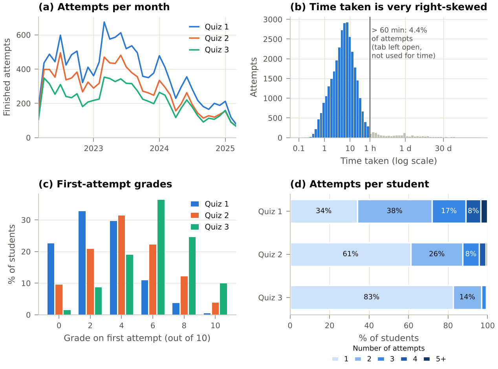{width=100%}

Figure 1 shows that Quiz 1 is much harder than the others: 55% of students
got 0 or 2 on their first try, while the average first-attempt grade in Quiz 3
is 6.1. Because of this, Quiz 1 also has the most re-attempts. Since the
quizzes are so different, we show them separately in most charts.

# 4. Methodology

We used Python with pandas for the data, matplotlib for the charts and SciPy
for simple statistics. One script (run_all.py) cleans the data, draws all
charts and saves every number used in this report.

For each hypothesis we followed the same steps:

1. Turn the hypothesis into something we can measure with our columns.
2. Pick the right part of the data. Most importantly, we kept **first attempts
   and re-attempts apart**, because a re-attempt is made after seeing the
   feedback.
3. Choose a chart that suits the data and the question.
4. Add a simple number to support the chart, such as a correlation or a
   percentage.
5. Decide: **Accepted**, **Partly accepted** or **Rejected**.

We used Spearman's correlation (ρ) for relationships, because it works well
with skewed time data. We also used chi-square tests and 95% confidence
intervals. With over 30,000 attempts almost every difference is "significant",
so we looked at how big the difference is, not only at p-values. We read
ρ below 0.1 as no real link, 0.1 to 0.3 as weak and above 0.3 as clear.

We used the same design rules in every chart:

- **Same colour, same meaning:** Quiz 1 blue, Quiz 2 orange, Quiz 3 green.
  Tiers use one blue from light (Low) to dark (High) because they are ordered.
  The colours were checked for colour-blind readers.
- **Position for the main comparison;** colour only for groups.
- **Log scale for time,** because a few very long times would squash the rest.
- **Show uncertainty:** 95% confidence bands or bars.
- **Keep it clean:** light grid lines, labels on the lines where possible, and
  no pie charts, 3D or double y-axes.

# 5. Results

## 5.1 Task 1: given hypotheses

### H1: Students who take longer score higher

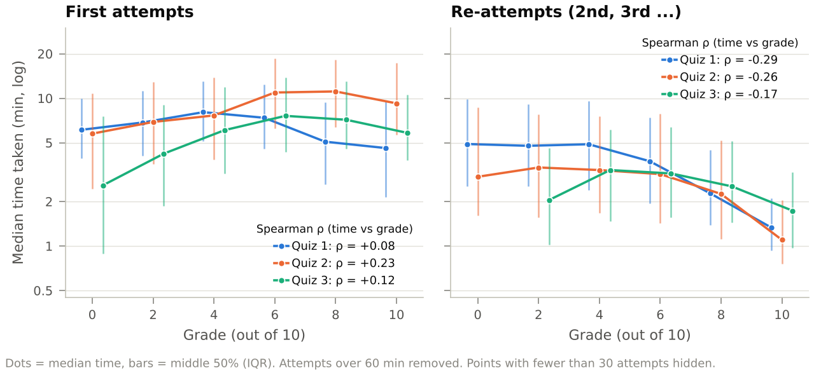{width=100%}

**Visualization.** Grades have only six values and there are 30,000 attempts,
so a scatter plot would just be six solid stripes. Instead, we show the median
time for each grade. *Marks:* points joined by lines, and vertical lines for
the spread. *Channels:* vertical position (log scale) for time, horizontal
position for grade, colour hue for quiz, and a separate panel for first
attempts and re-attempts.

**Findings.** On first attempts, time goes up a little with the grade, from
about 6 minutes for 0 marks to 8.5 minutes for 6 marks, but the link is weak
(ρ = 0.08 to 0.23) and students with full marks were not the slowest. On
re-attempts it is the opposite: the best re-attempts were the fastest (10/10
in about 1.3 minutes, ρ = −0.17 to −0.29). If we mix both groups the link
almost disappears (ρ = −0.08), which shows why the two must be kept apart.

**Decision: Partly accepted.** Only true, and only weakly, for first attempts.

### H2: Some questions are consistently harder than others

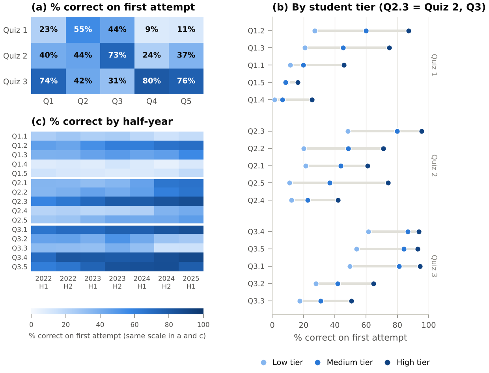{width=100%}

**Visualization.** The heatmaps (a, c) give a quick overview of all 15
questions, with the numbers written in (a). *Marks:* square areas.
*Channel:* colour lightness for % correct. The dot plot (b) compares tiers
accurately. *Marks:* points. *Channels:* horizontal position for % correct
and lightness of blue for tier.

**Findings.** The differences are large. In Quiz 1, 55% got Q1.2 right but
only 9% got Q1.4 right. The hardest questions are Q1.4 (9%), Q2.4 (24%) and
Q3.3 (31%). They stay the hardest for all three tiers (b) and over time (c):
the hardest question in each quiz was the hardest in 20 of the 21 quiz
half-years. A chi-square test agrees that the questions are not equally hard.

**Decision: Accepted.**

### H3: High performers improve steadily, low performers are erratic

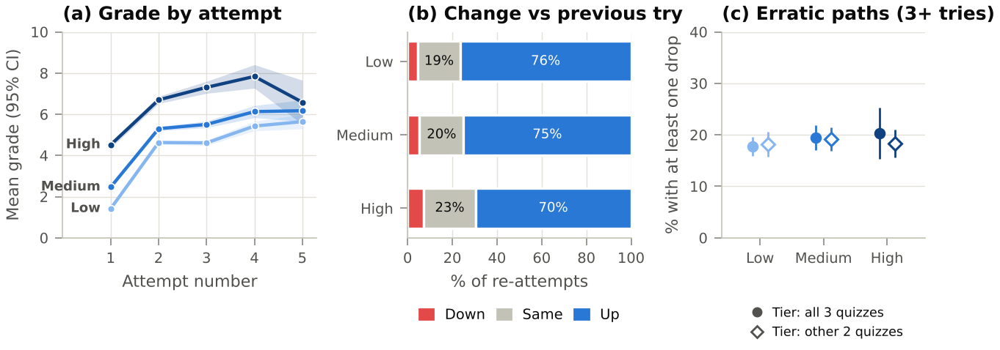{width=100%}

**Visualization.** Attempt number is ordered, so (a) is a line chart. *Marks:*
lines and points, with a shaded area for the confidence interval. *Channels:*
vertical position for grade and lightness for tier. Chart (b) uses stacked
bars where *length* shows the share and a red–grey–blue colour shows down,
same and up. Chart (c) uses points with error bars; the two shapes show two ways
of defining the tier (the second uses only the other two quizzes, as a check).

**Findings.** All tiers improve in the same way. In every tier 70–76% of
re-attempts go up and only 5–7% go down. Low performers actually gained the
most (+4.7 marks against +3.0 for High). About 18–20% of students in every tier
had at least one drop, so low performers are not more erratic.

**Decision: Rejected.**

### H4: Hard questions take longer, but strong students answer them faster

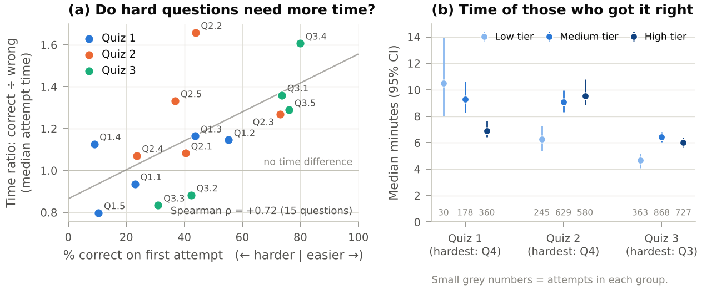{width=100%}

**Note.** The data only has the time for the whole attempt, not for each
question, so we could only test this indirectly. If a question needs more
time, students who got it right should have spent longer on the attempt.

**Visualization.** Chart (a) is a scatter plot of 15 questions. *Marks:*
points with labels. *Channels:* horizontal position for % correct, vertical
position for the time ratio (correct ÷ wrong) and hue for quiz. Chart (b)
shows medians with confidence intervals for each tier.

**Findings.** The points go up to the right (ρ = +0.72). So the extra time
pays off for easy questions, not hard ones. For the hardest questions, students
who got them right were not slower. In (b), High-tier students were faster only
in Quiz 1. In Quizzes 2 and 3 the Low tier was the fastest, and in general the
Low tier is the fastest group in every quiz. They seem to rush rather than to
struggle.

**Decision: Rejected** (with the note above).

### H5: There is an optimal time range

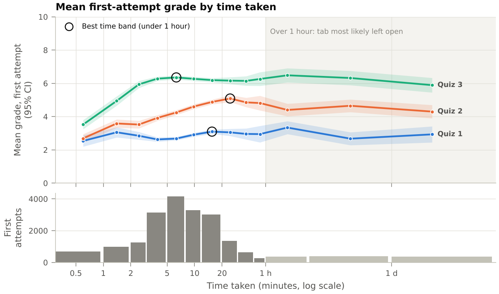{width=100%}

**Visualization.** We want to see the *shape* of a trend, so we used a line
chart. *Marks:* lines and points, a shaded area for the confidence interval,
and bars for the counts. *Channels:* horizontal position (log scale) for time,
vertical position for grade and hue for quiz. We kept the attempts over one
hour here, shaded grey, because "taking too long" is part of the hypothesis.
The counts are in a second panel instead of a second y-axis.

**Findings.** Finishing too fast is clearly bad: attempts under one minute
scored about 1.6 marks below average. Scores rise in the first few minutes and
then level off. The best band is different for each quiz: 5–8 minutes for
Quiz 3, 12–20 for Quiz 1 and 20–30 for Quiz 2. Taking a very long time only
lowers the score a little.

**Decision: Partly accepted.** The "too fast" part is true; the "too long"
part is weak.

## 5.2 Task 2: our own hypotheses

We based these on things we noticed while exploring the data: almost nobody
stopped below 4 out of 10, some re-attempts got full marks in under a minute,
and two questions were often left blank.

### H6: Students re-attempt to pass, not to get full marks

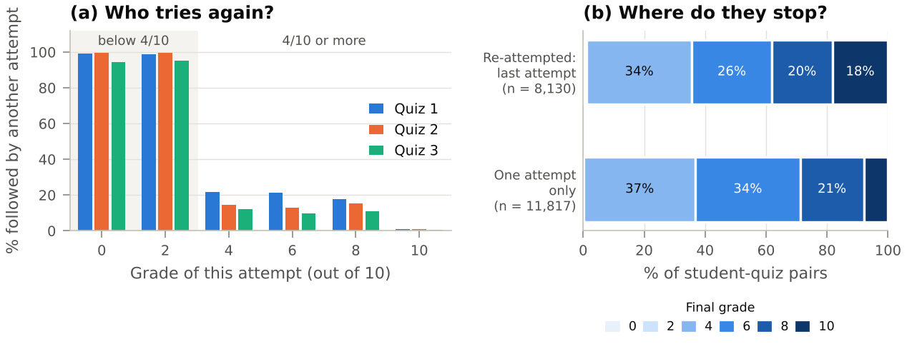{width=100%}

**Visualization.** Chart (a) uses grouped bars because we compare a percentage
that starts at zero. *Marks:* bars. *Channels:* length for the percentage,
horizontal position for grade and hue for quiz. Chart (b) uses stacked bars
where *length* shows the share and *lightness* shows the final grade. We did
not use pie charts because two pies are hard to compare.

**Findings.** There is a sharp drop, not a slow slope. After a grade of 0 or
2, students tried again 98.7% of the time. After 4, 6 or 8 only 15.6% tried
again. About a third (34.5%) of re-attempting students stopped at exactly 4,
and only 25 of 11,817 one-attempt students stopped below 4. This suggests the
pass mark is 4 out of 10 and that students aim for it and then stop.

**Decision: Accepted.**

### H7: Instant re-attempts reuse the feedback

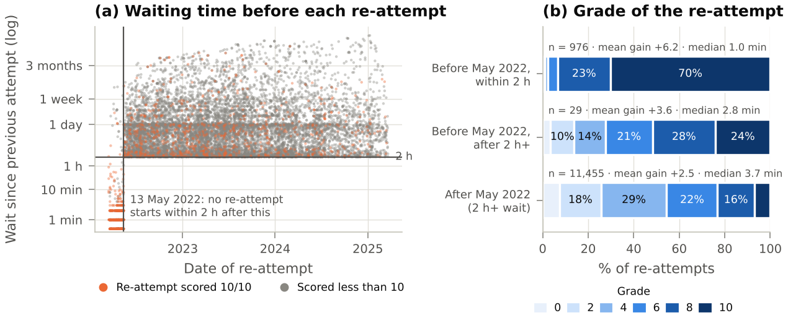{width=100%}

**Visualization.** Chart (a) is a scatter plot with one point per re-attempt,
so a sudden change is easy to see. *Marks:* points. *Channels:* horizontal
position for date, vertical position (log) for waiting time, and colour used
for *emphasis*: full marks in orange and the rest in grey. Chart (b) uses
stacked bars where length shows the share of each grade.

**Findings.** Up to 12 May 2022 many re-attempts started within a minute of
the last one. From 13 May 2022 no re-attempt starts within two hours. This
looks like a two-hour waiting time was switched on in Moodle. Before the
change, the quick re-attempts scored 9.2 out of 10 on average, 70% got full
marks and they took only about one minute. A five-question quiz cannot be read
and answered properly in one minute, so the students were most likely copying
the answers from the feedback of the last attempt. After the change, the
average gain fell from +6.2 to +2.5 marks and only 7% got full marks.

**Decision: Accepted.**

### H8: Students who do well in Quiz 1 also do well later

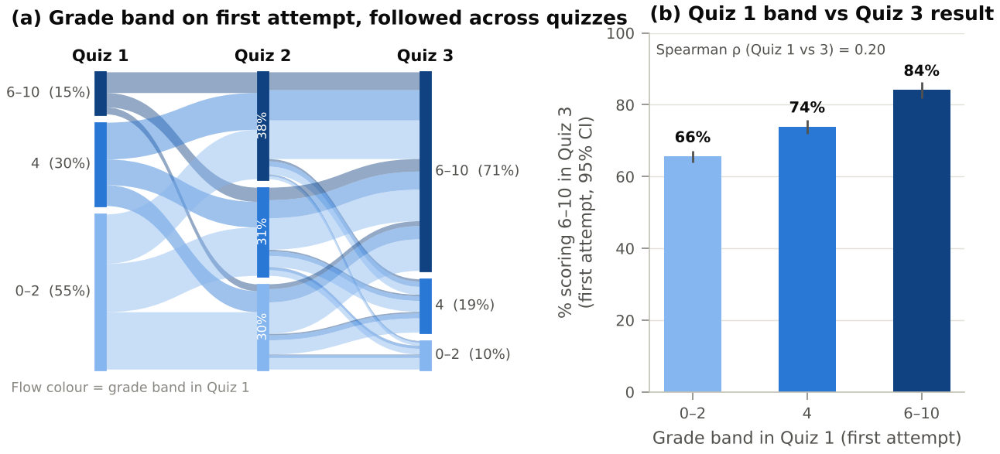{width=100%}

**Visualization.** We want to see how students move between bands, so we used
an alluvial diagram, which is made to show how groups move between categories. *Marks:*
blocks and flows. *Channels:* height of a block for the number of students,
width of a flow for the number moving, and lightness for the band in Quiz 1 so
a group can be followed. Chart (b) gives one clear number per band using bars.

**Findings.** The direction is right: 84% of students who scored 6–10 in
Quiz 1 also did so in Quiz 3, against 66% of those who scored 0–2. But there is
a lot of mixing, and the correlation between quizzes is weak (ρ ≈ 0.2). Only
43% of the top Quiz 1 students stayed in the top band in both later quizzes.

**Decision: Partly accepted.** Quiz 1 is only a weak guide to later results.

### H9: Later groups of students score higher

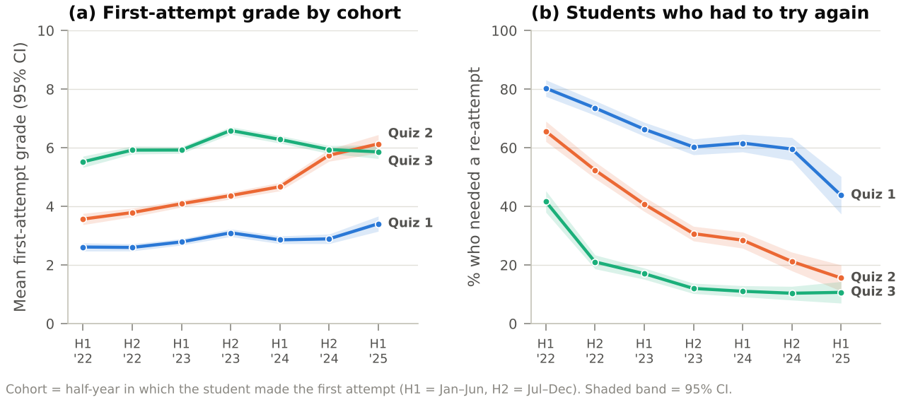{width=100%}

**Visualization.** Half-years are ordered in time, so we used line charts.
*Marks:* lines and points with shaded confidence bands. *Channels:* horizontal
position for half-year, vertical position for the value and hue for quiz.
The lines are labelled at their ends, so no legend is needed.

**Findings.** Quiz 2 improved a lot, from 3.6 in early 2022 to 6.1 in early
2025. Quiz 1 improved a little (2.6 to 3.4), and Quiz 3 shows no clear trend.
Fewer students needed a re-attempt in all quizzes. Some questions changed
suddenly in late 2024 (Figure 3c), so the questions may have been edited.

**Decision: Partly accepted.** True for Quiz 2, weak for Quiz 1, not for Quiz 3.

### H10: Leaving a question blank is a sign of low effort

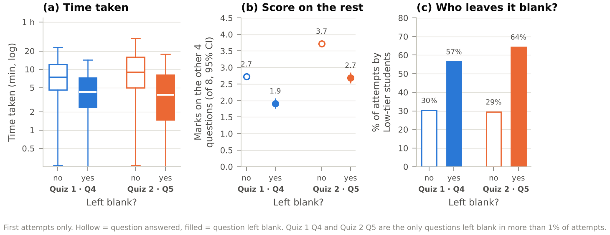{width=100%}

**Visualization.** Time is skewed, so (a) uses box plots on a log scale.
*Marks:* boxes and lines. *Channel:* vertical position for time. Charts (b)
and (c) use points and bars. In all three panels, *fill* (hollow or filled)
shows answered or blank, and hue shows the quiz.

**Findings.** Only Q1.4 and Q2.5 are often left blank (about 9% of first
attempts). Attempts with a blank finished much faster (4.3 vs 7.3 minutes for
Q1.4, and 3.8 vs 8.9 for Q2.5). They also got lower marks on the questions
they did answer (1.9 vs 2.7 out of 8, and 2.7 vs 3.7). More than half of them
came from Low-tier students.

**Decision: Accepted.**

# 6. Discussion

Looking at all results together, the **quiz rules shaped student behaviour
more than the time they spent**. The pass mark of 4 (H6) explains why almost
everyone's grade goes up over attempts in the same way (H3). The missing
waiting time before May 2022 (H7) allowed fast copied answers, and these fast,
high re-attempts are what reversed the time–score link in H1.

Speed also means different things for different students. Strong students were
not faster on hard questions (H4). It was the weaker students who were fastest,
who left questions blank (H10) and who finished in under a minute with low
marks (H5). This looks more like low effort than struggling.

The most stable thing in the data is question difficulty (H2). On the other
hand, a single quiz is a weak guide to a student's level (H8).

**What a teacher could do.** Keep the waiting time between attempts. Check
Q1.4, Q1.5 and Q3.3, because very few students get them right; Q1.5 is hard
even for the best students, which can mean unclear wording or a wrong answer
key. A blank answer or a first attempt under one minute could
be used as an early warning sign.

**Limitations.** We only have the time for the whole attempt, so H4 was tested
indirectly. The pass mark of 4 and the two-hour waiting time are worked out
from the data and should be confirmed with the course team. Our 60-minute
cut-off is a choice, but using 30, 45, 90 or 120 minutes changed the H1 results
by at most 0.01. Finally, these are patterns in the data, not proof of cause.

# 7. Conclusion

We cleaned three years of quiz data and used charts to check ten hypotheses.
Table 2 sums up the results.

Table: Table 2. Summary of all hypotheses.

| | Hypothesis                                           | Decision        |
|-----|----------------------------------------------------------|-------------------|
| H1  | Students who take longer score higher                    | Partly accepted   |
| H2  | Some questions consistently harder                       | Accepted          |
| H3  | High performers steady, low performers erratic           | Rejected          |
| H4  | Hard questions take longer; strong students faster       | Rejected          |
| H5  | There is an optimal time range                           | Partly accepted   |
| H6  | Students re-attempt to pass, not to get full marks       | Accepted          |
| H7  | Instant re-attempts reuse the feedback                   | Accepted          |
| H8  | Students good in Quiz 1 also do well later               | Partly accepted   |
| H9  | Later groups of students score higher                    | Partly accepted   |
| H10 | A blank answer is a sign of low effort                   | Accepted          |

Only one of the five given hypotheses (H2) was fully accepted. Our own
hypotheses showed that the pass mark and the waiting time between attempts
explain much of how students behave. The most useful step in this project was
to understand the data first and to split it correctly, especially first
attempts and re-attempts. Good chart design then made the patterns easy to see.
